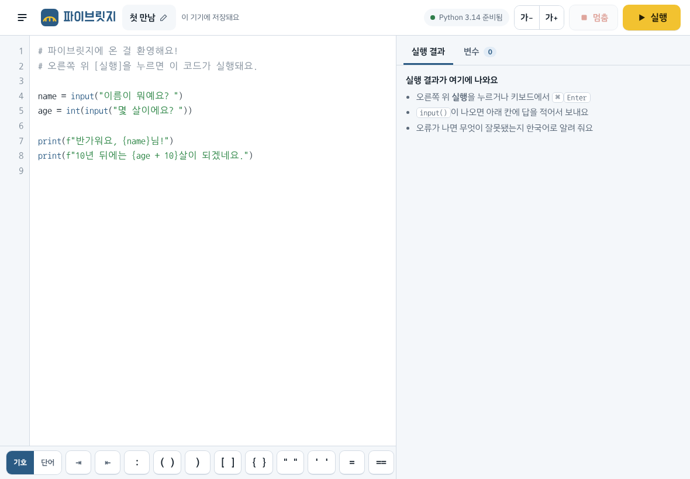
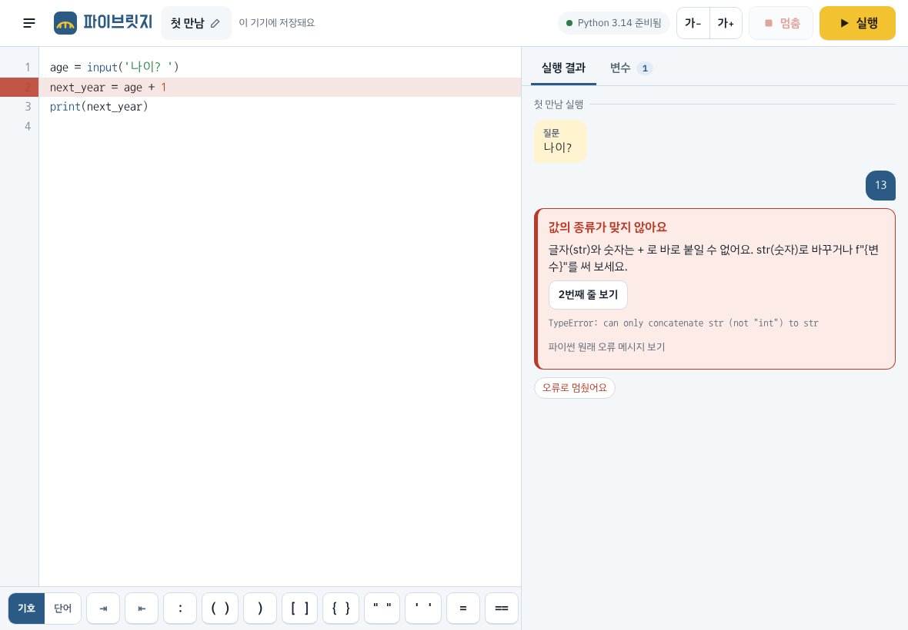
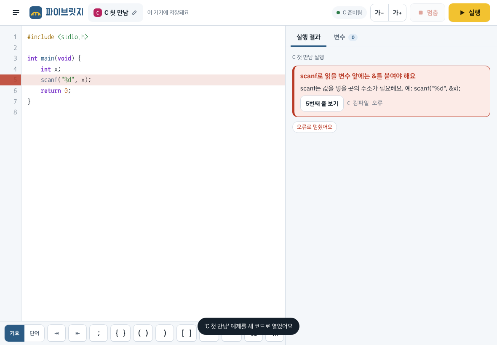

# my-first-game

Action에서 사용할 게임 만들기

## 파이브릿지 — 아이패드에서 쓰는 파이썬 · C 앱

설치 없이 **아이패드 Safari에서 바로** 파이썬과 C를 쓰고 실행하는 앱이에요.
파이썬은 아이패드 안에서 직접 돌아가요 ([Pyodide](https://pyodide.org) 사용).
나중에는 이름처럼 **파이썬 → C++ 변환**까지 이어 주는 다리가 될 예정이에요.

| 가로 화면 | 친절한 오류 안내 |
|---|---|
|  |  |

### C 실행기 (직접 만든 것)

C는 외부 컴파일러 없이, 이 저장소에서 직접 만든 C 실행기(`docs/js/c/`)로 돌아가요.
코드를 토큰 → 구문 트리(AST) → 검사 → 실행 순서로 처리하고, 이 구문 트리는 나중에
**언어 사이 변환**(C ↔ 파이썬 등)의 바탕이 돼요.

- 타입: `int` `double` `char` `long` 등 기본 타입, 배열(다차원, 가변 길이), 포인터와 이중 포인터,
  **구조체(`struct`)**, **`typedef`**, **`enum`**, **함수 포인터**, `int (*p)[3]` 같은 복잡한 선언
- 문장: 함수와 재귀, `if` `for` `while` `do` `switch`, `static` 지역 변수, 전역 변수,
  지정 초기화(`{.x = 1}`, `{[2] = 5}`)
- 전처리기: `#include` `#define`(매크로 함수 포함) `#if` `#ifdef` `#ifndef` `#elif` `#else` `#endif`
- 입출력: `printf`(실수 반올림까지 진짜 C와 똑같이) `scanf` `getchar` `fgets` `puts`,
  **파일**(`fopen` `fprintf` `fscanf` `fgets` `fputs` `fclose`, 앱 안의 가상 파일), **입력 끝(EOF)** 버튼
- 라이브러리: `string.h`(`strtok` `memcpy` 포함) `math.h` `ctype.h`
  `stdlib.h`(`malloc` `calloc` `free` `qsort` `bsearch` `rand`) `time.h`
- 아직 안 됨: `union`, `goto`, 비트 필드, 가변 인자 함수 만들기(`...`)
- 진짜 C는 그냥 넘어가지만 배우는 사람에게 중요한 실수를 한국어로 잡아 줘요:
  값을 넣지 않은 변수 사용, 배열 범위 벗어남, `scanf`의 `&` 빠뜨림, `%d`/`%f` 형식 불일치,
  `if (x = 5)`, 문자열을 `==`로 비교, 0으로 나누기, 끝없는 재귀, NULL 포인터,
  구조체 포인터에 `.`을 씀(`->`가 맞음), 없는 멤버, `free` 뒤 사용, 닫은 파일 사용



### 이 앱만의 특징

- **기호 키 바**: 아이패드 화면 키보드에서 찾기 힘든 `( ) [ ] : " = #` 같은 기호와
  `print()`, `for`, `def` 같은 단어를 한 번에 입력해요. 들여쓰기 ⇥ / 내어쓰기 ⇤ 버튼도 있어요.
- **대화형 실행 창**: `input()`의 질문은 말풍선으로, 내 답은 오른쪽 말풍선으로 보여요.
- **한국어 오류 설명**: 오류가 나면 무엇이 잘못됐고 어떻게 고치는지 쉬운 말로 알려 주고,
  틀린 줄을 빨갛게 표시해요. (예: `input()`으로 받은 값에 숫자를 더하면 `int()`를 쓰라고 알려 줘요)
- **변수 탭**: 실행이 끝나면 만들어진 변수의 이름, 종류, 값을 카드로 보여줘요.
- **아이패드에 맞춘 편집기**: 한글 입력이 자연스럽고, 아이패드가 따옴표를 “둥근 따옴표”로
  바꿔도 파이썬용 따옴표로 자동으로 되돌려요. `:` 다음 줄은 자동으로 들여 써요.
- **멈춤 버튼**: 무한 반복에 빠져도 앱은 멈추지 않고, 버튼 하나로 실행을 끝낼 수 있어요.
- **내 코드**: 코드는 이 기기에 자동 저장돼요. 예제 6개로 바로 시작할 수 있어요.
- **세로/가로 화면**, 다크 모드, 글자 크기 조절, 하드웨어 키보드 단축키(`⌘ Enter` 실행, `⌘ /` 주석)

### 아이패드에서 열기 (GitHub Pages)

1. GitHub에서 이 저장소의 **Settings → Pages**로 가요.
2. **Source**를 `Deploy from a branch`, 브랜치는 이 앱이 있는 브랜치, 폴더는 **`/docs`** 로 고르고 저장해요.
3. 1~2분 뒤 `https://<GitHub 아이디>.github.io/my-first-game/` 주소가 생겨요.
4. 아이패드 Safari에서 그 주소를 열고 **공유 버튼 → 홈 화면에 추가**를 누르면 앱처럼 쓸 수 있어요.
   한 번 열고 나면 인터넷이 없어도 실행돼요.

### 구조

| 파일 | 역할 |
|---|---|
| `docs/index.html`, `docs/style.css` | 화면 |
| `docs/js/app.js` | 화면을 움직이는 메인 코드 (실행 창, 서랍, 키 바, 대화상자) |
| `docs/js/editor.js` | 코드 편집기 (아이패드 기본 입력창 + 색칠 겹치기) |
| `docs/js/highlight.js` | 문법 색칠 |
| `docs/js/errors.js` | 오류를 한국어 설명으로 바꾸기 |
| `docs/js/engine.js` | 파이썬 엔진 켜기/실행/입력/멈춤 |
| `docs/worker.js` | 화면과 따로 파이썬을 돌리는 Web Worker |
| `docs/py/runner.py` | 엔진 안에서 사용자 코드를 실행하는 파이썬 코드 |
| `docs/js/c/` | 직접 만든 C 실행기 (lexer, parser, compile, runtime) |
| `docs/c-worker.js` | 화면과 따로 C를 돌리는 Web Worker |
| `docs/sw.js` | 한 번 열면 인터넷 없이도 쓸 수 있게 파일을 저장하는 서비스 워커 |

`input()`은 "다시 실행" 방식으로 처리해요. 답이 필요하면 실행을 멈추고 질문을 보여 주고,
답을 받으면 지금까지의 답을 모두 넣어 처음부터 다시 실행하되 이미 본 출력은 다시 보여주지 않아요.
`random`도 같은 씨앗으로 시작해서 결과가 바뀌지 않아요. 브라우저 기능에 기대지 않아서
아이패드, Claude 앱 미리보기 어디서나 같은 방식으로 동작해요.

### 테스트

```bash
python3 -m unittest discover -s tests       # 파이썬 실행기 (runner.py)
node --test tests/highlight.test.mjs        # 문법 색칠, 오류 설명
node --test tests/c.test.mjs                # C 실행기

# 실제 브라우저 테스트 (Playwright + Chromium 필요)
mkdir -p docs/vendor/pyodide && cd /tmp && npm pack pyodide@314.0.7 && tar xzf pyodide-314.0.7.tgz \
  && cp package/pyodide* package/python_stdlib.zip "$OLDPWD/docs/vendor/pyodide/" && cd -
node --test --test-concurrency=1 tests/e2e.test.mjs
```

`docs/vendor/`는 테스트용 엔진 사본이라 저장소에 올리지 않아요. 실제 앱은 jsDelivr CDN에서 엔진을 받아요.
