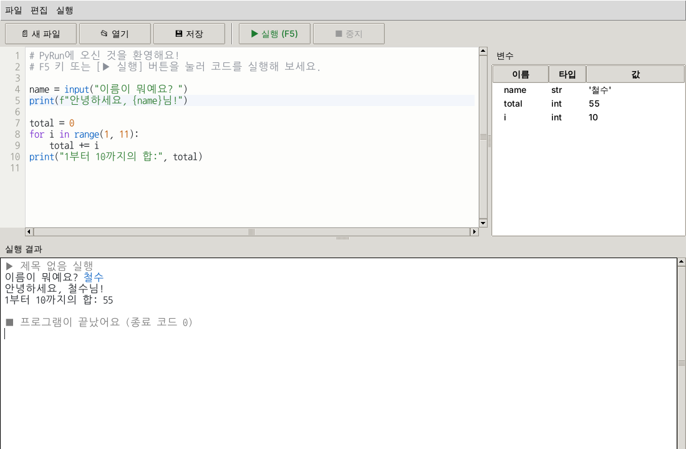

# my-first-game

Action에서 사용할 게임 만들기

## PyRun — 파이썬 편집기 겸 실행기

처음 배우는 사람이 쓰기 좋은 가벼운 파이썬 코드 편집기예요.
앞으로 여기에 **파이썬 → C++ 변환 기능**을 붙여 나갈 예정이에요.



### 실행 방법

파이썬 3.9 이상이 필요하고, 따로 설치할 패키지는 없어요 (tkinter만 있으면 돼요).

```bash
python run_pyrun.py            # 또는: python -m pyrun
python run_pyrun.py 내파일.py   # 파일을 바로 열기
```

> 리눅스에서 `No module named 'tkinter'` 오류가 나면 `sudo apt install python3-tk` 로 설치하세요.
> 윈도우/맥용 공식 파이썬에는 기본으로 들어 있어요.

### 기능

- **코드 편집기**: 줄 번호, 문법 색칠, 현재 줄 강조, 자동 들여쓰기(`:` 다음 줄), Tab/Shift+Tab 들여쓰기, 주석 넣기/빼기(`Ctrl+/`), 글자 크기 조절(`Ctrl++`, `Ctrl+-`)
- **실행**: `F5` 또는 ▶ 버튼. 코드는 별도 프로세스에서 실행되어서, 무한 반복에 빠져도 ■ 중지(`Ctrl+F2`)로 멈출 수 있어요
- **실행 결과 창**: 출력이 실시간으로 나오고, `input()`에 대한 답을 이 창에 바로 입력해요. 오류는 빨간색으로 표시돼요
- **오류 위치 표시**: 오류가 난 줄을 편집기에서 빨갛게 표시하고 그 줄로 이동해요
- **변수 패널**: 실행이 끝나면 (오류로 끝나도) 변수의 이름, 타입, 값을 보여줘요
- **파일**: 새 파일, 열기, 저장, 다른 이름으로 저장 (UTF-8). 저장하지 않은 코드도 바로 실행할 수 있어요

### 구조

| 파일 | 역할 |
|---|---|
| `pyrun/app.py` | 화면 (편집기, 실행 결과 창, 변수 패널, 메뉴) |
| `pyrun/runner.py` | 코드를 별도 프로세스로 실행하고 출력·입력을 주고받음 (화면과 분리) |
| `pyrun/_bootstrap.py` | 자식 프로세스에서 사용자 코드를 실행하고 변수 정보를 남김 |
| `pyrun/highlighter.py` | 문법 색칠용 분석기 |

### 테스트

```bash
python -m unittest discover -s tests -t .
# 화면 테스트까지 하려면 화면이 있어야 해요. 리눅스 서버에서는:
xvfb-run -a python -m unittest discover -s tests -t .
```
